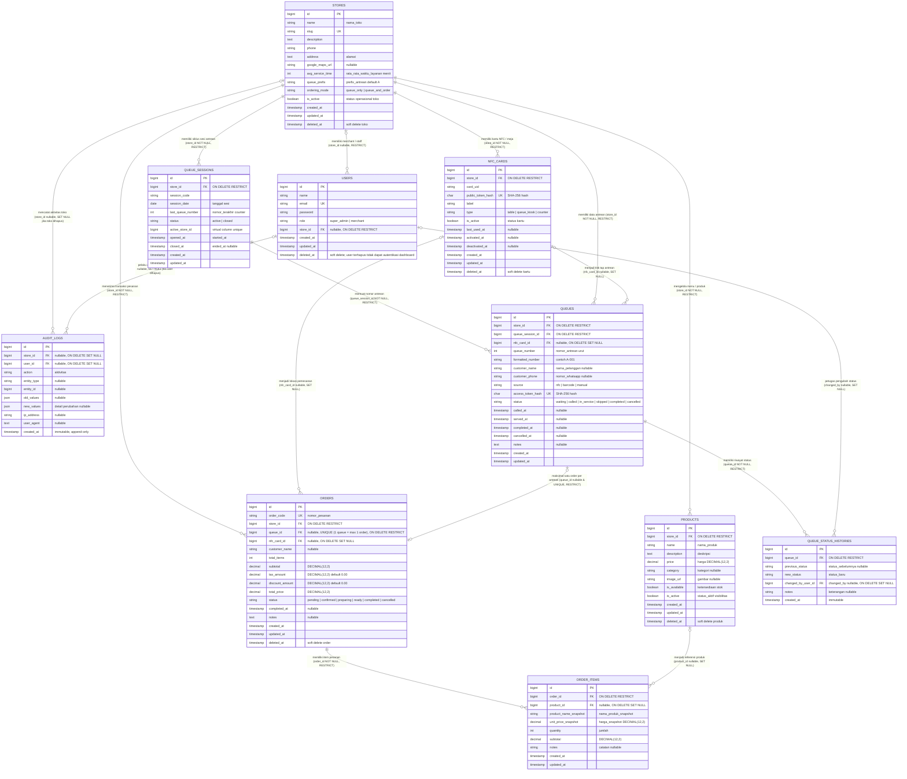

# TAPZY — Entity Relationship Diagram (ERD) & Architecture — v1.5.1 Final

Dokumen ini mendefinisikan rancangan visual relasi antar tabel (ERD), dependensi foreign key, urutan migration, serta analisis integritas teknis basis data untuk platform SaaS **TAPZY** (NFC Smart Queue & Ordering Platform) berdasarkan audit koreksi kardinalitas v1.5.1.

---

## 1. Diagram Relasi Entitas (Mermaid ERD)



---

## 2. Urutan Migration & Dependensi Foreign Key

Urutan eksekusi migration dirancang sesuai pohon dependensi foreign key tanpa mengacu pada tabel yang belum ada:

```text
Urutan Eksekusi Migration:
1.  0001_01_01_000000_create_users_table.php (Bawaan Laravel: users, password_reset_tokens, sessions)
2.  0001_01_01_000001_create_cache_table.php (Bawaan Laravel: cache, cache_locks)
3.  0001_01_01_000002_create_jobs_table.php (Bawaan Laravel: jobs, job_batches, failed_jobs)
4.  2026_11_05_140418_create_personal_access_tokens_table.php (Tabel PAT tersedia untuk kebutuhan integrasi mendatang; bukan autentikasi dashboard)
5.  xxxx_xx_xx_000001_create_stores_table.php (Entitas tenant utama)
6.  xxxx_xx_xx_000002_add_tenant_columns_to_users_table.php (Menambahkan role, store_id FK [RESTRICT], dan deleted_at soft delete ke users)
7.  xxxx_xx_xx_000003_create_nfc_cards_table.php (FK -> stores [RESTRICT])
8.  xxxx_xx_xx_000004_create_queue_sessions_table.php (FK -> stores [RESTRICT], active_store_id virtual column, UNIQUE uq_store_session_code)
9.  xxxx_xx_xx_000005_create_queues_table.php (FK -> stores [RESTRICT], queue_sessions [RESTRICT], nfc_cards [SET NULL])
10. xxxx_xx_xx_000006_create_products_table.php (FK -> stores [RESTRICT])
11. xxxx_xx_xx_000007_create_orders_table.php (FK -> stores [RESTRICT], queues [RESTRICT, UNIQUE uq_orders_queue_id], nfc_cards [SET NULL])
12. xxxx_xx_xx_000008_create_order_items_table.php (FK -> orders [RESTRICT], products [SET NULL])
13. xxxx_xx_xx_000009_create_queue_status_histories_table.php (FK -> queues [RESTRICT], users [SET NULL])
14. xxxx_xx_xx_000010_create_audit_logs_table.php (FK -> stores [SET NULL], users [SET NULL])
```

---

## 3. Matriks Kebijakan Foreign Key Deletion (Final v1.5.1)

Seluruh foreign key telah difinalisasi untuk memastikan perlindungan histori bisnis dan audit di level engine MySQL:

| No | Relasi Foreign Key | Tabel Anak (Kolom FK) | Tabel Induk | Kebijakan Deletion | Dasar Pertimbangan Teknis & Integritas |
| :---: | :--- | :--- | :--- | :---: | :--- |
| 1 | `stores → queues` | `queues.store_id` | `stores.id` | **RESTRICT** | Mencegah hard delete toko menghapus riwayat antrean pelanggan di level database. |
| 2 | `stores → queue_sessions` | `queue_sessions.store_id` | `stores.id` | **RESTRICT** | Mencegah terhapusnya siklus sesi antrean operasional saat ada upaya penghapusan toko. |
| 3 | `stores → products` | `products.store_id` | `stores.id` | **RESTRICT** | Melindungi katalog produk master; produk hanya boleh dinonaktifkan atau di-soft delete. |
| 4 | `stores → nfc_cards` | `nfc_cards.store_id` | `stores.id` | **RESTRICT** | Mencegah hilangnya data aset kartu fisik jika toko dihapus secara fisik. |
| 5 | `stores → orders` | `orders.store_id` | `stores.id` | **RESTRICT** | Melindungi transaksi keuangan pesanan agar pembukuan tidak hilang karena hard delete toko. |
| 6 | `queues → queue_status_histories` | `queue_status_histories.queue_id` | `queues.id` | **RESTRICT** | Mencegah penghapusan tiket antrean jika sudah memiliki riwayat perubahan status audit. |
| 7 | `orders → order_items` | `order_items.order_id` | `orders.id` | **RESTRICT** | **Proteksi Finansial:** Mencegah hard delete pesanan menghapus detail baris transaksinya. |
| 8 | `queues → orders` | `orders.queue_id` | `queues.id` | **RESTRICT** | **Proteksi Audit:** Mencegah antrean di-hard delete jika telah menghasilkan pesanan. |
| 9 | `users → stores` | `users.store_id` | `stores.id` | **RESTRICT** | Toko tidak dapat di-hard delete jika masih ada akun merchant terikat. *(Super admin tetap diizinkan `store_id = NULL`)*. |
| 10 | `products → order_items` | `order_items.product_id` | `products.id` | **SET NULL** | Jika master produk dihapus fisik, baris pesanan tetap aman karena nama dan harga sudah tersimpan di snapshot. |
| 11 | `nfc_cards → queues` | `queues.nfc_card_id` | `nfc_cards.id` | **SET NULL** | Jika kartu fisik dinonaktifkan/dihapus, tiket antrean pelanggan tetap sah dan tidak hilang. |
| 12 | `nfc_cards → orders` | `orders.nfc_card_id` | `nfc_cards.id` | **SET NULL** | Jika kartu meja dihapus, transaksi pesanan meja tetap tersimpan utuh. |
| 13 | `audit_logs → stores` | `audit_logs.store_id` | `stores.id` | **SET NULL** | Menjamin log audit platform tidak hilang saat toko dihapus; kolom relasi menjadi `NULL` namun detail JSON tetap utuh. |
| 14 | `audit_logs → users` | `audit_logs.user_id` | `users.id` | **SET NULL** | Menjamin log audit tidak hilang saat pengguna dihapus. |
| 15 | `queue_sessions → queues` | `queues.queue_session_id` | `queue_sessions.id` | **RESTRICT** | Mencegah sesi di-hard delete jika sudah memiliki tiket antrean. |
| 16 | `users → queue_status_histories` | `queue_status_histories.changed_by_user_id` | `users.id` | **SET NULL** | Jika akun petugas dihapus, rekam jejak audit status antrean tetap aman. |

### Penegasan Mekanisme Penghapusan:
- **Soft Delete (`deleted_at`):** Dijalankan pada level aplikasi (Eloquent ORM). Baris fisik tetap ada di tabel MySQL dan foreign key relasi **tidak memicu action `ON DELETE`**.
- **Hard Delete (`DELETE FROM`):** Menghapus baris fisik dari storage engine disk MySQL.
- **`ON DELETE RESTRICT` (Database Level):** Database MySQL secara mutlak membatalkan query hard delete parent dan menghasilkan error `SQLSTATE[23000]: 1451 Cannot delete or update a parent row` jika child row masih ada.
- **`ON DELETE SET NULL` (Database Level):** Database MySQL mengubah nilai foreign key pada child menjadi `NULL`, menjaga child row tetap eksis tanpa tautan parent.

---

## 4. Constraint Khusus & Penegakan Integritas

1. **One Queue = Maximum One Order (`1:0..1`):**
   - Kolom `orders.queue_id` dipasangi **`UNIQUE KEY uq_orders_queue_id (queue_id)`**.
   - Kolom bersifat `NULLABLE`. Di MySQL/InnoDB, nilai `NULL` diizinkan berulang kali (order meja tanpa antrean), namun melarang duplikasi nilai `queue_id` yang sama. Notasi visual Mermaid: `QUEUES o|--o| ORDERS`.
2. **Satu Sesi Aktif per Toko:**
   - Kolom virtual `queue_sessions.active_store_id` dipasangi **`UNIQUE KEY uq_store_single_active_session (active_store_id)`**.
3. **Keunikan Kode Sesi per Toko:**
   - Kolom `queue_sessions.session_code` dipasangi **`UNIQUE KEY uq_store_session_code (store_id, session_code)`**.

---

## 5. Changelog Revisi Desain

| Versi | Tanggal | Ringkasan Revisi |
| :---: | :---: | :--- |
| **v1.0** | 2026-11-05 | Inisialisasi awal 10 entitas database. |
| **v1.1** | 2026-11-05 | Urutan migration, hash SHA-256 token, dan virtual column `active_store_id`. |
| **v1.2** | 2026-11-05 | Penerapan One Queue = Maximum One Order dan soft delete merchant. |
| **v1.3** | 2026-11-05 | Penyelarasan penuh PRD v1.0, penghapusan kolom pembayaran, dan integrasi migration Sanctum riil. |
| **v1.4** | 2026-11-05 | Penegasan ketiadaan `users.is_active`, unique `session_code`, dan pengetatan foreign key. |
| **v1.5** | 2026-11-06 | Finalisasi reset antrean skipped, matriks foreign key deletion 16 relasi, dan kebijakan soft/hard delete. |
| **v1.5.1 (Final)** | 2026-11-06 | **Koreksi Kardinalitas Visual Mermaid ERD:** Menyelaraskan notasi relasi nullable menggunakan `|o` dan `o|` pada 8 relasi opsional (`STORES-USERS`, `STORES-AUDIT_LOGS`, `USERS-AUDIT_LOGS`, `USERS-QUEUE_STATUS_HISTORIES`, `NFC_CARDS-QUEUES`, `NFC_CARDS-ORDERS`, `PRODUCTS-ORDER_ITEMS`, dan `QUEUES-ORDERS`), memastikan diagram Mermaid 100% presisi mencerminkan nullability kolom foreign key pada Data Dictionary v1.5. |
